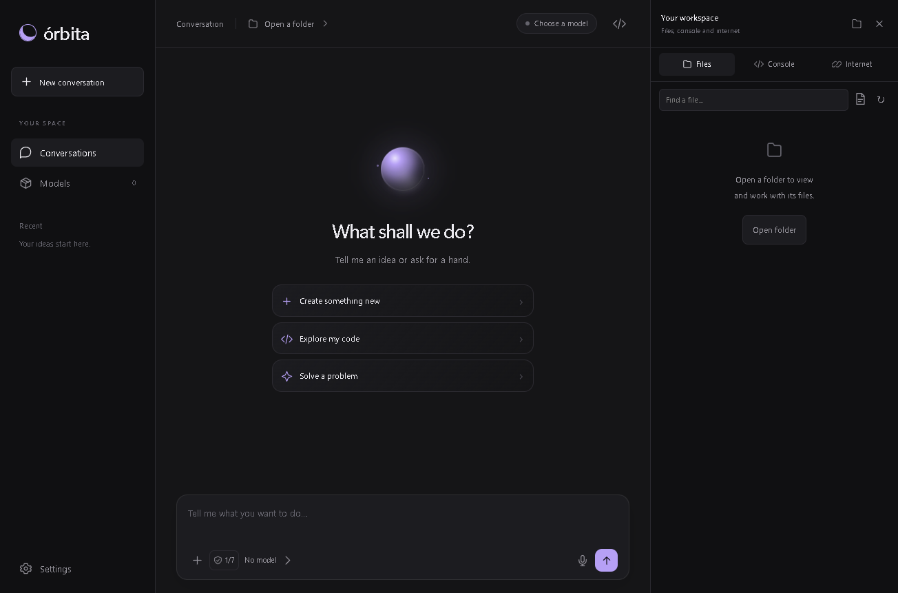

# Órbita

**A simple desktop coding assistant for local models.**

Chat, create and edit real project files, run commands, and read the web from one quiet workspace. Model inference and voice transcription run on your computer. No app account, API key, subscription, or telemetry.

Órbita is free and open source under the [MIT License](LICENSE). The public project and documentation are in English; Spanish is also available in the app.



## What it does

- **One chat:** the assistant decides whether to answer or use tools. Coding requests are instructed to create actual files, not just display a code block.
- **A workspace beside the chat:** browse folders, open files, edit and save text, see changes, and recover supported edits or deletions.
- **A live console:** run commands, read their output, send input, and stop processes. The assistant can use the same tools with your chosen permissions.
- **Public web tools:** search and read page text. An integrated Hugging Face window helps find public models.
- **Keep writing while it works:** messages join a queue. Edit or remove pending messages; pause and resume the queue.
- **Local voice typing:** speak, review the transcription in the draft, then send it yourself.
- **Memory you control:** ask it to remember a preference, or review, edit, and delete memories in Settings.
- **Project tools:** open documents in another app, show a folder in Explorer, and export a project to ZIP.
- **Personal settings:** dark theme by default, configurable colors, typography, layout, thinking animation, CPU/GPU use, context, and generation settings.

## Run from source

This version targets **Windows 10/11, x64**. Install **Node.js 20 or newer** and Git, then run in PowerShell:

```powershell
git clone https://github.com/TaWADAaaa/orbita.git
cd orbita
npm install
npm start
```

The first launch prepares the pinned Electron desktop runtime and checks its SHA-256 checksum. Internet access is needed for this download. You can also prepare it explicitly with `npm run setup`. PowerShell must be available to unpack downloaded runtimes.

Then:

1. Open **Models** and add a model using one of exactly three sources: **Hugging Face**, a **Hugging Face model link**, or a **local GGUF file**.
2. Prepare the local model engine when prompted. Órbita downloads an official llama.cpp Windows runtime. CPU mode works without a supported GPU; GPU availability depends on the selected runtime and your hardware.
3. Open your project folder with **+**, or ask for a new project. If file tools need a folder and none is selected, the app creates one under its local data folder.
4. Start with **access level 1**. Approve a proposed action after reading it, or choose a higher level when it fits your task.

The source checkout does not include a language model. [Qwen2.5-Coder-1.5B-Instruct-GGUF](https://huggingface.co/Qwen/Qwen2.5-Coder-1.5B-Instruct-GGUF) is a small compatible starting point; choose a single-file instruction/chat GGUF that fits your RAM or VRAM. Model quality affects coding and tool use. Small models can misunderstand requests or choose the wrong tool.

You can run `npm run package` to create a portable Windows build. Model weights and personal data are not added to the source repository.

## Seven access levels

Choose a level using the small permissions control beside the message box. It is saved and applies to the **next task**. At any level, an action above that level asks for approval.

| Level | Actions the AI can perform without another approval |
| --- | --- |
| 1 — Restricted | None; every tool action asks, including reading |
| 2 — Read files | Read, list, and search project files |
| 3 — Create files | Also create files, folders, new ZIPs, and requested memories |
| 4 — Edit files | Also edit existing files and replace existing ZIPs |
| 5 — Use internet | Also search and read public webpages |
| 6 — Use console | Also run commands, manage console sessions, and open project documents in other apps |
| 7 — Full access | Also delete project files and requested memories |

These are approval levels, **not a Windows sandbox**. Console commands run with your Windows account's permissions and can change or delete files outside the project. They do not have automatic undo. Direct project file tools stay within the chosen folder and reject unsafe paths and links. Manual editor and button actions are actions you initiate.

The app saves a backup before supported file changes. **Undo** and **Recover file** check for conflicting changes so they do not silently replace your later edits. See [Security](SECURITY.md) for the complete boundaries.

## Voice, memory, and local data

Voice typing uses whisper.cpp and a multilingual Whisper tiny model. The first use downloads the verified speech runtime and model. Allow microphone access for desktop apps in Windows. Record up to two minutes, then stop; the transcription goes into an editable draft. Temporary audio files are removed after transcription.

Conversations, memories, settings, model configuration, and edit backups are stored in:

```text
%APPDATA%\Orbita Local
```

New automatic projects are in its `Projects` subfolder. App data is stored as local files and is not encrypted by Órbita. You can review memory in **Settings → How it works → Memory**. Requested memory creation follows level 3 and deletion follows level 7; lower levels ask first. Removing a model from the model list does not delete its original file.

Inference works offline once its required model and runtime are installed. Web searches, page reads, Hugging Face browsing, and downloads use the internet; their queries and URLs go to the respective external services. There is no cloud model fallback.

## Current limits

- Windows x64 is the supported desktop target. macOS and Linux builds are not provided by this setup.
- Models must be public, single-file GGUF text/chat models. Split GGUF files, image projection models, and models requiring a login are not supported.
- The console handles text streams and input; it is not a full interactive terminal emulator. Full-screen console programs need their own window.
- Web tools return public page text. They do not sign into sites or automate arbitrary browser pages. Hugging Face browsing is limited to public model pages.
- Project ZIP export uses stored entries, includes binary files and empty folders, and skips known private files, links, and dependency folders. Its limits are **128 MiB total file content, 64 MiB per file, and fewer than 5,000 entries**. Check an archive before sharing it; exclusions are not a complete secret scanner.
- The assistant can make mistakes. Verify generated work, especially commands and changes that matter to you.

If the model cannot load, try a smaller model, reduce context, or choose CPU mode. Use **Stop** or **Escape** to interrupt work. Stopping pauses queued messages so they can be reviewed before continuing.

## Development

```powershell
npm test
```

The unit suite uses Node's built-in test runner. Additional UI integration tests use Playwright and may need a local model, downloaded speech tools, and internet access. See [Contributing](CONTRIBUTING.md) before running those tests.

The application is plain Electron, HTML/CSS, and CommonJS JavaScript. The renderer communicates through an allowlisted preload bridge; tool approval, file validation, process control, model management, and public-web handling live in backend modules. All application source is in this repository. Downloaded runtime binaries, model weights, personal data, recordings, caches, backups, and generated test output are excluded.

## Support development

Donations are optional. Use the exact asset and network shown:

| Asset | Network | Address |
| --- | --- | --- |
| BTC | Bitcoin mainnet, native BTC | `bc1qt696cljgmhhwswdt2ulpwpmzdnc5fhuw4k8lz5` |
| SOL | Solana mainnet, native SOL | `3jmHYhw4iNcqSLvb5GxwDZev2qNx853TESEYYeEj3NYx` |
| USDT | BNB Smart Chain, BEP-20 | `0x5D7c7e1055C2381a402b9e7F73d2cFa78f23c0F5` |

See [Donations](DONATIONS.md) for details. Donations are not required for any feature.

## License

Órbita source: [MIT](LICENSE), copyright 2026 Órbita contributors. External engines, dependencies, and model weights retain their licenses; see [Third-party notices](THIRD_PARTY_NOTICES.md).
